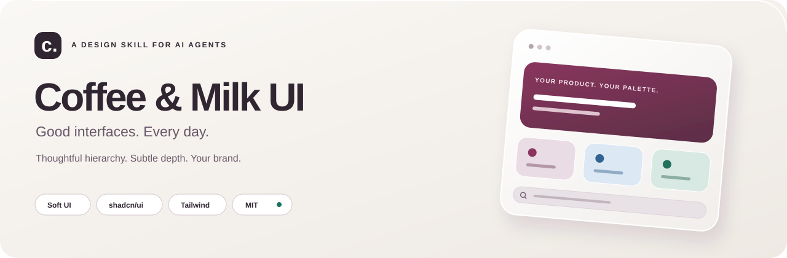
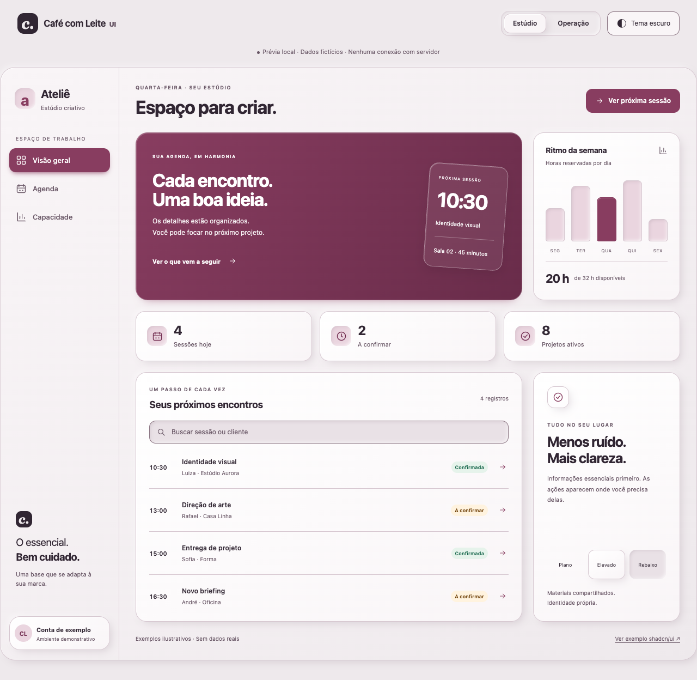
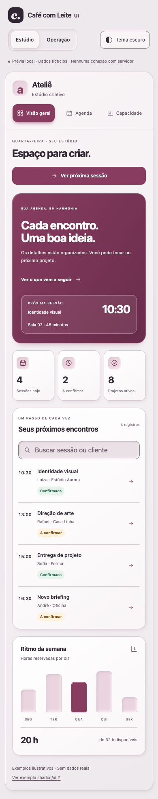
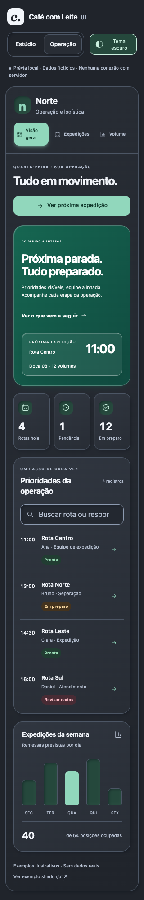

# Café com Leite UI



### The everyday essentials of thoughtful interface design.

[](https://github.com/icaroortiz/cafe-com-leite-ui/actions/workflows/ci.yml)
[](CHANGELOG.md)
[](LICENSE)

[Live gallery](https://icaroortiz.github.io/cafe-com-leite-ui/) · [React + shadcn demo](https://icaroortiz.github.io/cafe-com-leite-ui/react/) · [AI integration](docs/AI-INTEGRATION.md) · [Português brasileiro](README.pt-BR.md)

A reusable **AI coding skill for dashboards and internal tools**. It brings clear hierarchy, subtle Soft UI depth, coherent colors and practical **shadcn/ui + Tailwind** guidance to your existing project.

**The name is Brazilian. The palette belongs to your product.**



## A foundation, with room for your brand

| Principle | What it changes |
| --- | --- |
| Structure before decoration | The task, reading order and primary action determine the layout. |
| Depth with restraint | Raised groups and inset controls; dense tables and chats stay relatively flat. |
| One material, different brands | Semantic tokens adapt to your palette, density and vocabulary. |
| Behavior stays intact | Keep existing components, focus management, permissions and business rules. |

This is **a skill, optional CSS and working examples**. It is not a component-library package, a fixed dashboard template or a reason to migrate your stack. Its strongest fit is workspaces, admin areas and operational products. Marketing pages need their own direction.

## Get started

Clone the repository:

```sh
git clone https://github.com/icaroortiz/cafe-com-leite-ui.git
cd cafe-com-leite-ui
```

### Install in Codex

Copy the self-contained skill folder, including its license and references:

```sh
skill_root="${CODEX_HOME:-$HOME/.codex}/skills"
skill_target="$skill_root/cafe-com-leite-ui"
if [ -e "$skill_target" ]; then
  printf 'Already installed: %s — compare before replacing.\n' "$skill_target"
else
  mkdir -p "$skill_root" && cp -R skills/cafe-com-leite-ui "$skill_target"
fi
```

Open a new Codex conversation and use:

```text
Use $cafe-com-leite-ui to refine this dashboard.
Keep our brand, existing features and current stack. Prepare one
representative screen and an important error or empty state before
extending the direction. Check desktop, mobile and the supported themes.
```

The command preserves an existing installation. If your client does not discover the skill, give it the installed `SKILL.md` path explicitly.

### Use with another coding agent

Keep the skill folder in your workspace and ask the agent to read `skills/cafe-com-leite-ui/SKILL.md`, then only the references relevant to the task. No particular client's automatic discovery is assumed. The [integration guide](docs/AI-INTEGRATION.md) includes reusable prompts, token guidance and a focused adoption workflow.

## What's inside

| Resource | Purpose |
| --- | --- |
| [Skill](skills/cafe-com-leite-ui/SKILL.md) | Focused instructions and progressive reference loading. |
| [Design system](skills/cafe-com-leite-ui/references/design-system.md) | Color, elevation, density, states, mobile and motion. |
| [shadcn recipes](skills/cafe-com-leite-ui/references/shadcn-recipes.md) | Existing components, token formats and portal theming. |
| [CSS preset](skills/cafe-com-leite-ui/assets/soft-ui.css) | Optional namespaced light/dark surfaces. |
| [Visual gallery](examples/gallery/) | Burgundy studio and teal operations examples, with no build step. |
| [React example](examples/react-shadcn/) | Real shadcn components, a validated form and a themed dialog. |

All sample data is fictional. Demo actions stay local; no authentication, payments or backend are connected.

<details>
<summary><strong>Mobile and dark-theme previews</strong></summary>

<p>
  
  
</p>

</details>

## Run locally

**Static gallery:** from the repository root:

```sh
python3 -m http.server 8765 --bind 127.0.0.1
```

Open [localhost:8765/examples/gallery](http://127.0.0.1:8765/examples/gallery/). The installable skill also contains a [small material sample](skills/cafe-com-leite-ui/assets/material-preview.html).

**React + shadcn:** use Node.js 22.12 or newer:

```sh
cd examples/react-shadcn
npm ci
npm run dev
```

The [example README](examples/react-shadcn/README.md) documents its pinned toolchain, interaction model and local-only data.

## Quality and checks

From the repository root:

```sh
python3 scripts/check_repository.py
npm --prefix examples/react-shadcn ci
npm --prefix examples/react-shadcn run typecheck
npm --prefix examples/react-shadcn run build
```

The initial examples were checked in Chrome at desktop and 390/320 px viewport widths, including dark themes, form validation, keyboard focus and dialog behavior. Read the [validation record](docs/VALIDATION.md) for results and limits. Those checks do not claim physical-device coverage or a complete accessibility certification.

The example uses **Tailwind 3**. Guidance also discusses token compatibility, but does not claim that every framework, shadcn release or Tailwind version has been tested.

## Contribute

Start with an interface problem, a small change and evidence that the result works. Contributions in English and Brazilian Portuguese are welcome.

- [Contribution guide](CONTRIBUTING.md)
- [Repository instructions for AI contributors](AGENTS.md)
- [Changelog](CHANGELOG.md)

## Origins and license

Created by [Ícaro Ortiz](https://github.com/icaroortiz), from practical work on the Tocwise interface, then generalized for other products.

[Neomorphism Metric Card by Arun Dass](https://21st.dev/@arunjdass/components/neomorphism-metric-card) is a visual reference for soft shadows and edge lighting. Its source, screenshots and assets are not redistributed here. The React example includes official shadcn component source with its license preserved.

Original material is available under the **[MIT License](LICENSE)**. See [third-party notices](THIRD_PARTY_NOTICES.md). This is an independent project, not affiliated with shadcn/ui, Tailwind or 21st.dev.
