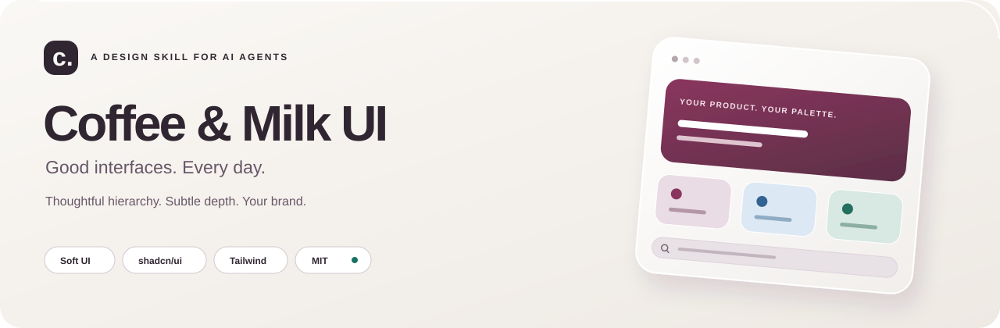
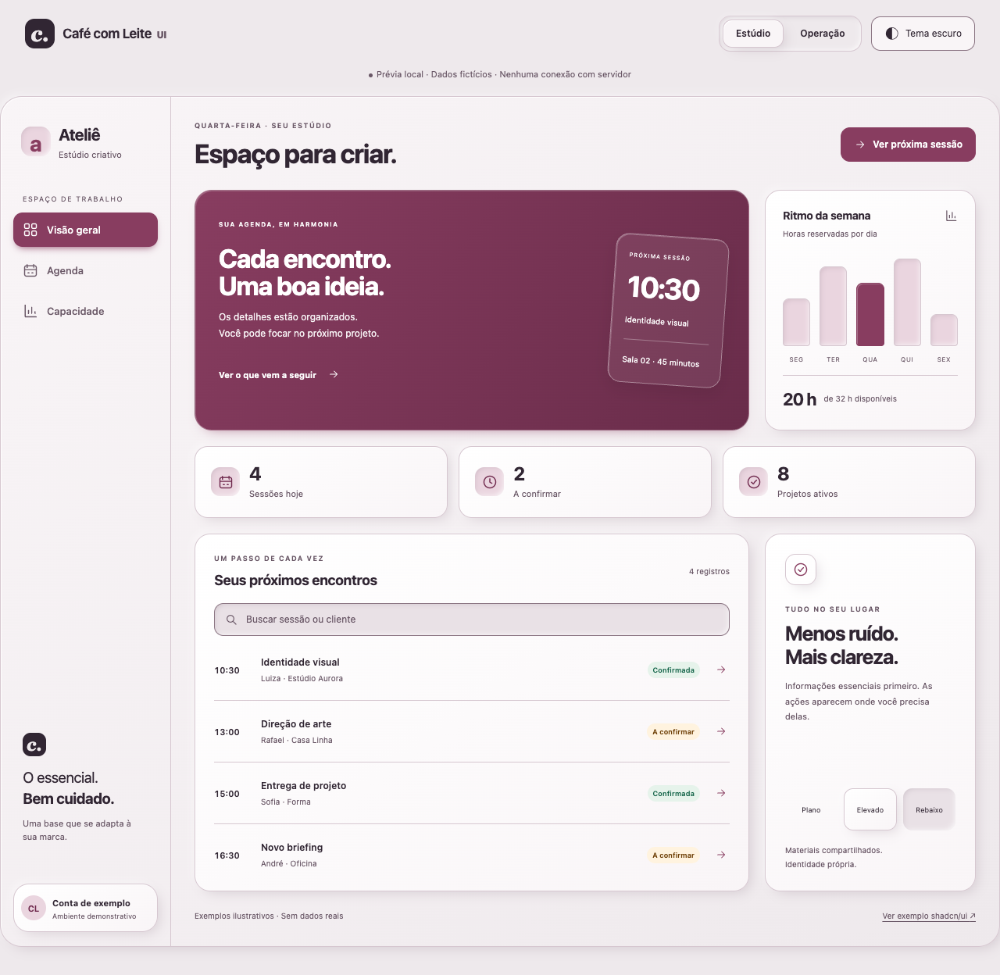
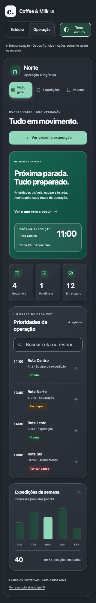

# Coffee & Milk UI



### O essencial do dia a dia para ótimas interfaces.

[](https://github.com/icaroortiz/coffee-and-milk-ui/actions/workflows/ci.yml)
[](CHANGELOG.md)
[](LICENSE)

[Instalar e usar](docs/QUICKSTART.pt-BR.md) · [Galeria online](https://icaroortiz.github.io/coffee-and-milk-ui/) · [Demo React + shadcn](https://icaroortiz.github.io/coffee-and-milk-ui/react/) · [Baixar v0.2.0](https://github.com/icaroortiz/coffee-and-milk-ui/releases/tag/v0.2.0) · [Integração com IA](docs/AI-INTEGRATION.md) · [English](README.md)

Uma **skill reutilizável para agentes de programação criarem dashboards e áreas internas**. Traz hierarquia clara, profundidade discreta de Soft UI, cores coerentes e orientações práticas de **shadcn/ui + Tailwind** para o projeto que você já tem.

**Compatível com Codex e Claude Code.** Instale a mesma skill no cliente que preferir seguindo as instruções abaixo.

**O básico bem-feito:** tipografia clara, espaçamento consistente, controles acessíveis e respostas úteis às ações. Seu produto mantém a própria paleta e identidade.



## Uma base, com espaço para a sua marca

| Princípio | O que muda na prática |
| --- | --- |
| Estrutura antes da decoração | A tarefa, a ordem de leitura e a ação principal orientam o layout. |
| Profundidade com medida | Grupos elevados e controles rebaixados; tabelas densas e chats ficam mais planos. |
| Um acabamento, marcas diferentes | Tokens semânticos se adaptam à sua paleta, densidade e linguagem. |
| Comportamento preservado | Mantenha componentes, foco, permissões e regras de negócio existentes. |

Este pacote reúne **uma skill, CSS opcional e exemplos funcionais**. Não é uma biblioteca de componentes, um template fixo de dashboard ou um motivo para trocar sua stack. Seu melhor ponto de partida são áreas de trabalho, administração e produtos operacionais. Páginas de marketing precisam de uma direção própria.

## Comece por aqui

Instale uma vez no **Codex ou Claude Code** e invoque a skill no projeto que deseja melhorar. A instalação disponibiliza as orientações; não modifica a aplicação sozinha. O [guia rápido](docs/QUICKSTART.pt-BR.md) inclui um prompt completo para copiar e instruções para outras IAs.

### Instalar no Codex

Cole isto **no chat do Codex**, não no terminal:

```text
$skill-installer instale a skill em https://github.com/icaroortiz/coffee-and-milk-ui/tree/main/skills/coffee-and-milk-ui
```

Ou use o **terminal**, com Node.js 22.20+ e a [CLI Skills](https://github.com/vercel-labs/skills):

```sh
npx skills add icaroortiz/coffee-and-milk-ui --skill coffee-and-milk-ui --agent codex --global
```

Escolha uma forma de instalação. `--global` disponibiliza a skill entre projetos; retire essa opção para instalar somente no projeto atual. O Codex detecta novas skills automaticamente; reinicie se ela não aparecer. Consulte a [orientação oficial do Codex](https://learn.chatgpt.com/docs/build-skills).

Depois abra seu projeto e peça:

```text
Use $coffee-and-milk-ui para refinar este dashboard.
Preserve nossa marca, as funcionalidades e a stack atual. Prepare uma tela
representativa e um estado importante de erro ou vazio antes de ampliar
a direção. Confira desktop, celular e os temas disponíveis.
```

### Instalar no Claude Code

No **terminal**, com Node.js 22.20+ e a [CLI Skills](https://github.com/vercel-labs/skills):

```sh
npx skills add icaroortiz/coffee-and-milk-ui --skill coffee-and-milk-ui --agent claude-code --global
```

`--global` disponibiliza a skill entre projetos; para instalar somente no projeto atual, execute dentro dele e retire essa opção. Depois abra seu projeto no Claude Code e peça:

```text
/coffee-and-milk-ui Refine este dashboard.
Preserve nossa marca, as funcionalidades e a stack atual. Prepare uma tela
representativa e um estado importante de erro ou vazio antes de ampliar
a direção. Confira desktop, celular e os temas disponíveis.
```

O Claude Code usa `/coffee-and-milk-ui`; o Codex usa `$coffee-and-milk-ui`. O [guia rápido](docs/QUICKSTART.pt-BR.md) também explica como copiar a pasta completa para os diretórios de skills do Claude Code. Consulte a [documentação oficial do Claude Code](https://code.claude.com/docs/en/skills).

Use o [prompt completo](docs/QUICKSTART.pt-BR.md#2-cole-este-prompt-no-projeto) em qualquer um dos dois clientes para incluir shadcn, tokens, acessibilidade e comportamento no mobile/PWA.

### Usar com outro agente de programação

Mantenha a pasta da skill no seu workspace e peça ao agente para ler `skills/coffee-and-milk-ui/SKILL.md`, seguido apenas das referências relevantes à tarefa. Não pressupomos descoberta automática em outros clientes. O [guia de integração](docs/AI-INTEGRATION.md) inclui prompts reutilizáveis, orientações de tokens e um fluxo de adoção por etapas.

## O que vem no pacote

| Recurso | Para que serve |
| --- | --- |
| [Skill](skills/coffee-and-milk-ui/SKILL.md) | Instruções focadas e leitura progressiva das referências. |
| [Sistema visual](skills/coffee-and-milk-ui/references/design-system.md) | Cor, relevo, densidade, estados, mobile e movimento. |
| [Receitas shadcn](skills/coffee-and-milk-ui/references/shadcn-recipes.md) | Componentes existentes, formatos de tokens e temas em portais. |
| [Preset CSS](skills/coffee-and-milk-ui/assets/soft-ui.css) | Superfícies claro/escuro opcionais, com escopo próprio. |
| [Galeria visual](examples/gallery/) | Agenda em vinho e operação em verde-petróleo, sem etapa de build. |
| [Exemplo React](examples/react-shadcn/) | Componentes reais do shadcn, formulário validado e modal com tema. |

Todos os dados são fictícios. As ações das demos são locais; não há autenticação, pagamentos ou backend conectados.

<details>
<summary><strong>Prévias mobile e de tema escuro</strong></summary>

<p>
  
  
</p>

</details>

## Rodar localmente

Para consultar o código ou rodar os exemplos, clone o repositório:

```sh
git clone https://github.com/icaroortiz/coffee-and-milk-ui.git
cd coffee-and-milk-ui
```

**Galeria estática:** na raiz do repositório:

```sh
python3 -m http.server 8765 --bind 127.0.0.1
```

Abra [localhost:8765/examples/gallery](http://127.0.0.1:8765/examples/gallery/). A skill instalável também inclui uma [amostra pequena de materiais](skills/coffee-and-milk-ui/assets/material-preview.html).

**React + shadcn:** use Node.js 22.12 ou mais recente:

```sh
cd examples/react-shadcn
npm ci
npm run dev
```

O [README do exemplo](examples/react-shadcn/README.md) descreve as versões fixadas, as interações e os dados mantidos somente em memória.

## Qualidade e verificações

Na raiz do repositório:

```sh
python3 scripts/check_repository.py
npm --prefix examples/react-shadcn ci
npm --prefix examples/react-shadcn run typecheck
npm --prefix examples/react-shadcn run build
```

Os exemplos iniciais foram conferidos no Chrome em desktop e larguras de 390/320 px, incluindo temas escuros, validação do formulário, foco por teclado e comportamento do modal. Consulte o [registro de validação](docs/VALIDATION.md) para os resultados e limites. Esses testes não representam cobertura em aparelhos físicos nem certificação completa de acessibilidade.

O exemplo usa **Tailwind 3**. As orientações também discutem compatibilidade de tokens, mas não afirmam que todas as versões de frameworks, shadcn ou Tailwind foram testadas.

## Contribuir

Comece por um problema de interface, uma alteração pequena e evidência de que o resultado funciona. Contribuições em português e inglês são bem-vindas.

- [Guia de contribuição](CONTRIBUTING.md)
- [Instruções do repositório para agentes de IA](AGENTS.md)
- [Changelog](CHANGELOG.md)

## Origem e licença

Criada por [Ícaro Ortiz](https://github.com/icaroortiz), a partir do trabalho prático na interface da Tocwise, e adaptada para outros produtos.

O [Neomorphism Metric Card de Arun Dass](https://21st.dev/@arunjdass/components/neomorphism-metric-card) é uma referência visual para sombras suaves e luz nas bordas. Seu código, screenshots e assets não são redistribuídos aqui. O exemplo React inclui componentes oficiais do shadcn com a licença preservada.

O material original está disponível sob a **[licença MIT](LICENSE)**. Consulte os [avisos de terceiros](THIRD_PARTY_NOTICES.md). Este é um projeto independente, sem vínculo oficial com shadcn/ui, Tailwind ou 21st.dev.
